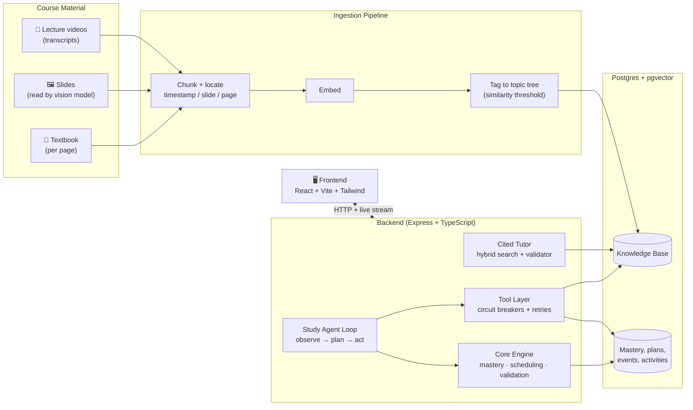
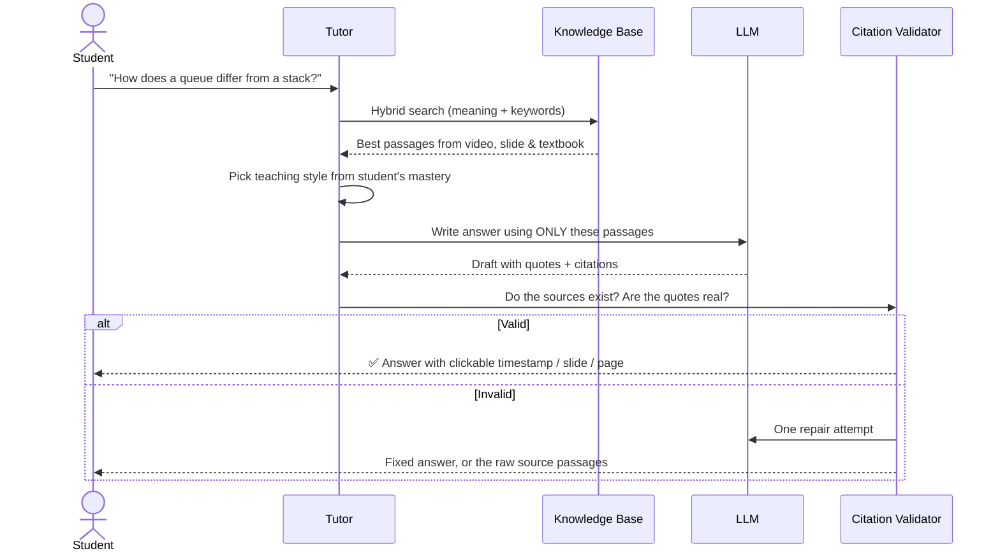
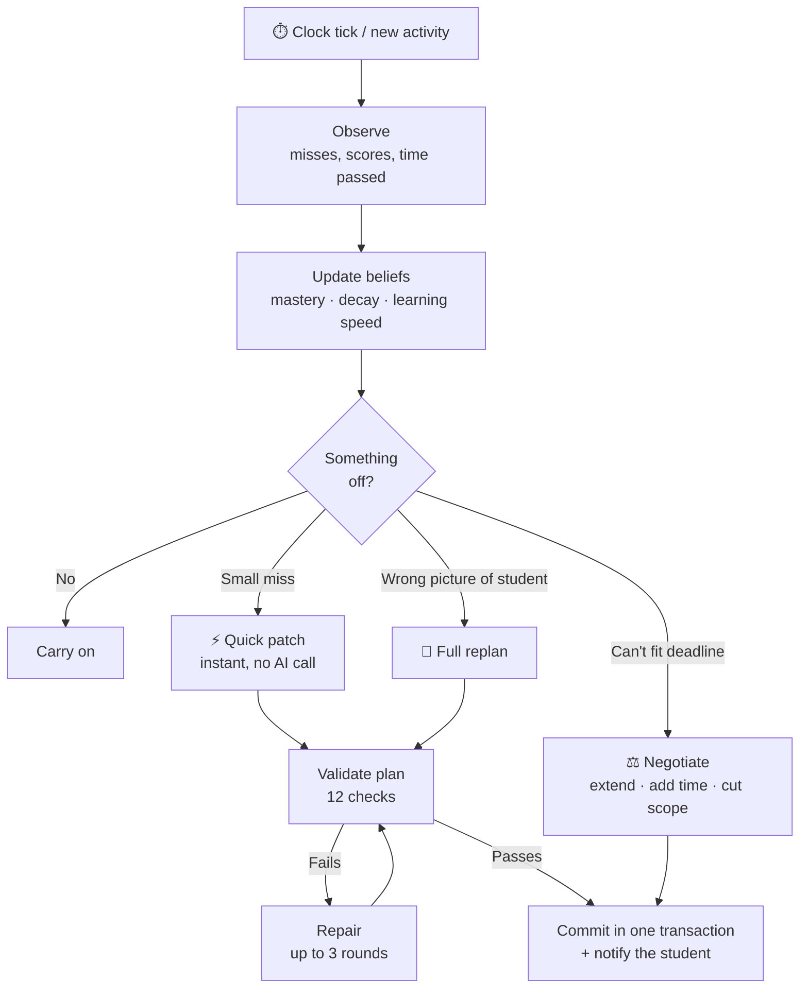

# 🌸 Bloom

### A study companion that cites its sources, notices when you're slipping, and fixes your plan before you fall behind.

Students don't fail because they lack material. They fail because the material is scattered across lecture videos, slides and textbooks, their study plan never adapts, and nobody tells them they're about to forget what they learned last week.

Bloom fixes both problems:

1. **Ask anything, get a proof, not a guess.** Bloom merges lecture videos, slides and a textbook into one searchable knowledge base. Every answer points to the exact **video timestamp, slide or textbook page**, and any answer whose citation doesn't check out is rejected before you see it.
2. **A plan that reacts to you.** Miss a session, bomb a quiz, or start forgetting a topic, and Bloom rewrites your schedule automatically, without being asked.

---

## 🎬 Demo

<!-- Upload your video to GitHub (drag & drop into this file in the GitHub editor, or into an issue/PR comment) and paste the generated link below, replacing this block. -->


> **📹 Demo video: coming here**
>

https://github.com/user-attachments/assets/4b274e6e-a737-4c66-b389-0aa61a3f1ec5


<!-- Optional: add screenshots -->
<!--  -->
<!--  -->

---

## ✨ What makes it different

| | |
|---|---|
| 📚 **One brain for all your material** | Lecture video, slides (diagrams included, read by a vision model) and textbook pages live in a single index. |
| 🔗 **Every answer is verifiable** | One answer can cite a lecture at 12:40, slide 4 and textbook page 87 together. Click a citation to jump straight to the source. |
| 🛡️ **Citations are checked, not trusted** | A validator confirms the passage exists, the quoted words really appear in it, and the location resolves. Fails → one repair attempt → safe fallback. No evidence? Bloom says so instead of making something up. |
| 🧭 **Self-correcting study plan** | Tracks mastery per topic, forecasts forgetting, and re-plans on its own when you miss sessions, score low, or a deadline is at risk. |
| ⚖️ **Honest about impossible goals** | If your deadline can't fit the work, Bloom doesn't fake a schedule. It offers real trade-offs: extend the deadline, add study time, or cut scope. |
| 🔌 **Keeps working when things break** | If a tool fails, Bloom falls back to the last good result, flags it, and recovers automatically. You can break things live in the demo. |
| 🎯 **Questions that come from your course** | Quiz questions are generated from your material and accepted only if the answer is quoted from it. A wrong answer links back to the exact passage that explains it. |

---

## 🏗️ Architecture



**Design principle:** the AI writes words, code makes decisions. Mastery scores, schedules, deadlines, citation locations and validation are all deterministic code. The language model only handles explanations, diagnosing why an answer was wrong, choosing among pre-vetted resources, and phrasing. The whole system still runs with the model turned off.

---

## 🔄 How it works

### 1. Asking a question



### 2. Staying on track



Triggers include: missed sessions, low quiz scores, **forgetting risk** (Bloom schedules recall practice *before* you forget), approaching deadlines, and **confusion** (ask about the same topic twice while unsure and a quick test is inserted automatically).

---

## 🖥️ The app

Nine screens: **Dashboard · Study Plan · Topic Progress · Library · Tutor · Assessment · Agent Activity · Plan Changes · Eval**, plus a **Source Viewer** side panel for jumping to cited material.

A built-in **Demo Panel** lets you fast-forward time and break things on purpose (the resource lookup, the knowledge base, a tutor citation) to watch Bloom degrade gracefully and recover.

---

## 🧰 Tech stack

| Layer | Tech |
|---|---|
| Frontend | React, Vite, Tailwind |
| Backend | Node, Express, TypeScript, Zod |
| Data | Postgres + pgvector, Drizzle ORM |
| AI | Gemini (embeddings, vision for slides, text generation) |
| Testing | Vitest |

---

## 🚀 Run it locally

```bash
# Requires Postgres with the pgvector extension
createdb bloom
psql -d bloom -c "CREATE EXTENSION IF NOT EXISTS vector;"

cp backend/.env.example backend/.env   # set DATABASE_URL (and GEMINI_API_KEY for AI features)
npm install
npm run migrate
npm run seed
npm run dev        # backend :4000, frontend :5173
```

Run tests with `npm run test`.

<details>
<summary><b>Load your own course material</b></summary>

Needs `GEMINI_API_KEY`, plus `pdftotext` / `pdftoppm` (poppler).

```bash
# Describe your files in backend/kb-manifest.json, then:
npm run ingest:video && npm run ingest:slides && npm run ingest:textbook
npm run kb:report                                  # coverage overview
npm run kb:segments                                # make material plannable
npm run generate:questions -- --from-kb dsa
npm run mark:reviewed -- --kb dsa --list           # review answer keys
npm run mark:reviewed -- --kb dsa --approve
npm run eval:kb                                    # measure tutor quality
```
</details>

<details>
<summary><b>Authentication, CORS and rate limits</b></summary>

- `POST /api/auth/register` and `/api/auth/login` return a signed 7-day token (`Authorization: Bearer <token>`; the live stream uses `?token=`).
- Set `AUTH_REQUIRED=true` and a 32+ character `AUTH_SECRET` to enforce per-student access. It is off by default for the local demo.
- Allowed origins come from `CORS_ORIGINS`; unset allows only localhost.
- Rate limits apply per student (or IP): sign-in 10/min, tutor 20/min, agent 30/min, all configurable.
</details>

---

## 🔍 Honest scope

We'd rather tell you what's real than oversell it.

| ✅ Real | 🧪 Simulated / limited |
|---|---|
| Video, slides and textbook indexed together with exact locations | Ingestion is a command-line step, not an upload screen |
| Vision model reads slides, including diagram-only ones | Video is indexed by transcript; frames aren't analysed |
| Every shown answer passes the citation check | The check proves a source exists and was quoted, not that the paraphrase is perfectly faithful |
| DSA questions generated from material and human-reviewed | Other subjects' question banks are AI-generated and flagged unreviewed |
| Mastery model, planner, validator and failure handling | Passage of time (the demo uses a simulated clock) |

One course slice (DSA) is fully ingested for the demo; other subjects show a clear "no material yet" state.

**Built during the hackathon:** the knowledge base and ingesters, vision step for slides, cited tutor and citation validator, grounded question generation, confusion detection, and the Library / Tutor / Source Viewer screens.
**Built before:** the study-plan agent, mastery model, planner, validator and resilience layer.

---


https://github.com/user-attachments/assets/8a0f56e3-71a1-44e8-8e55-76edf4a72fe0


